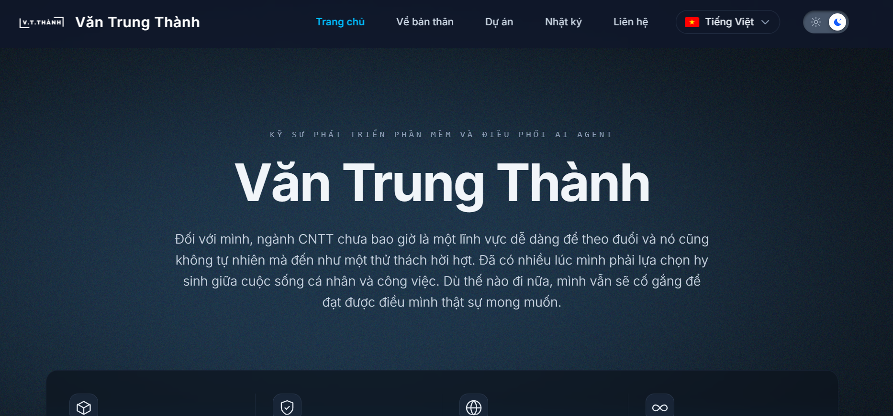
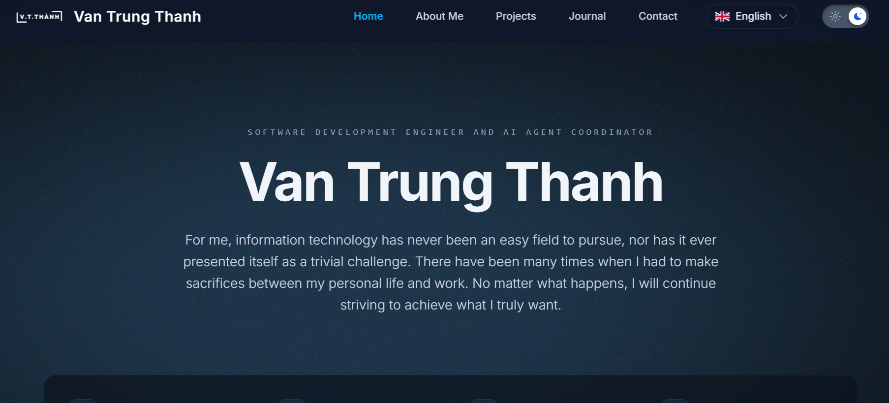
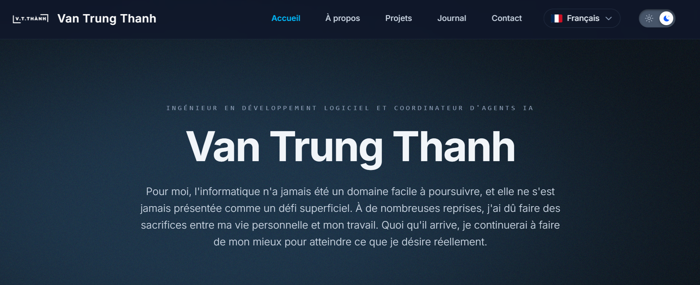
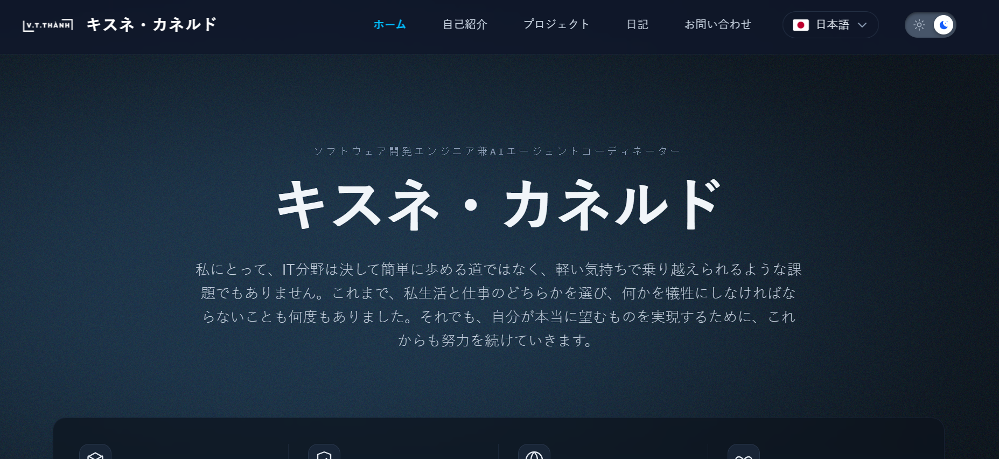
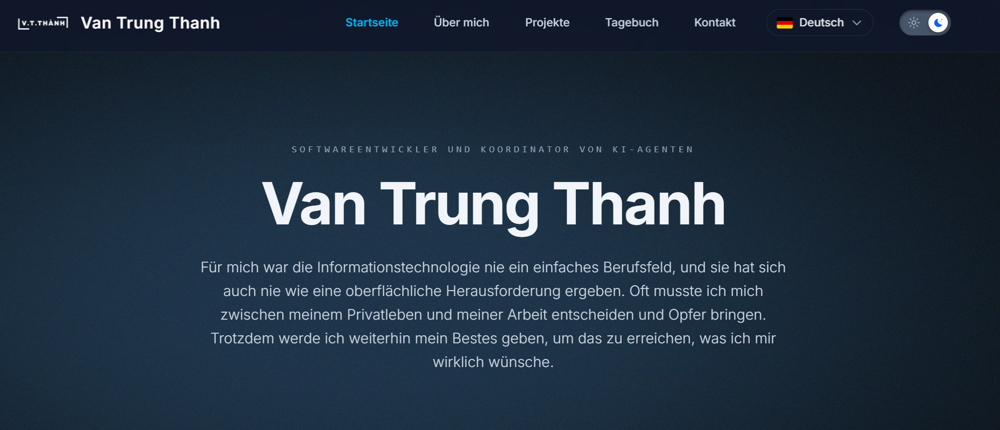
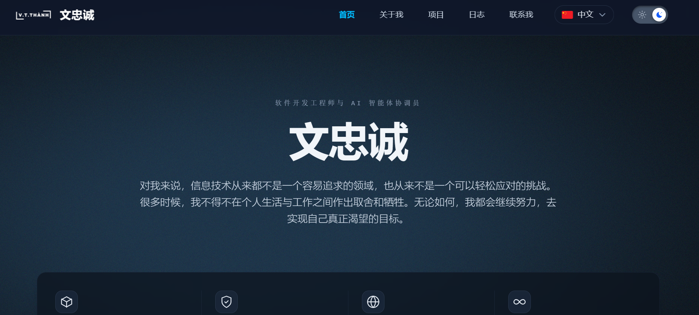
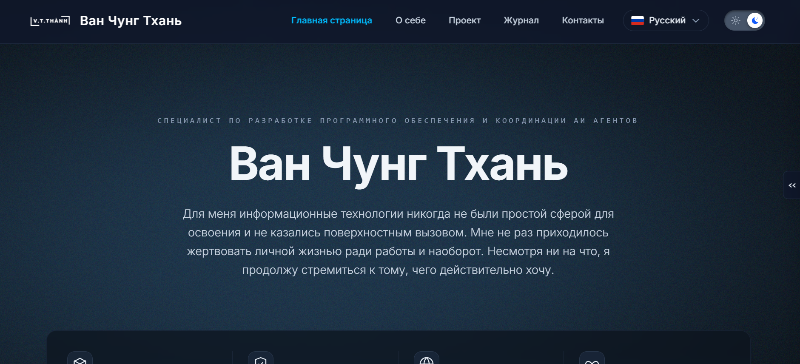
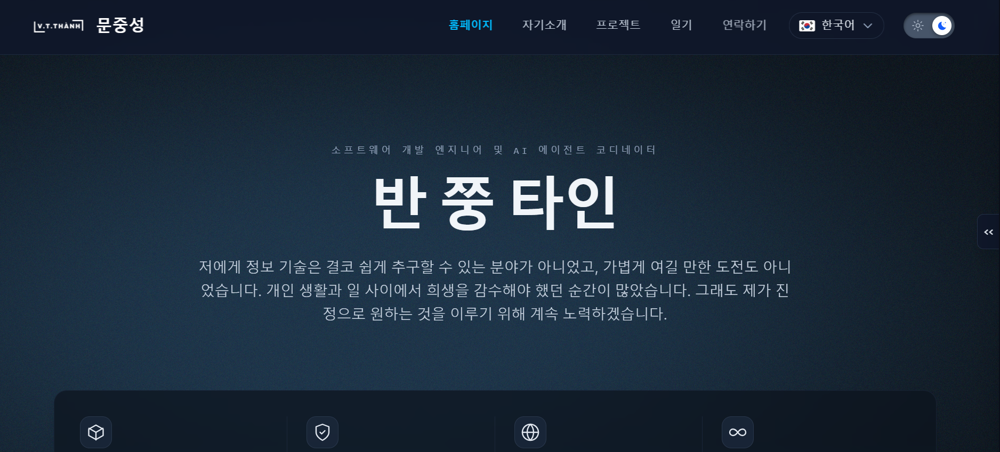
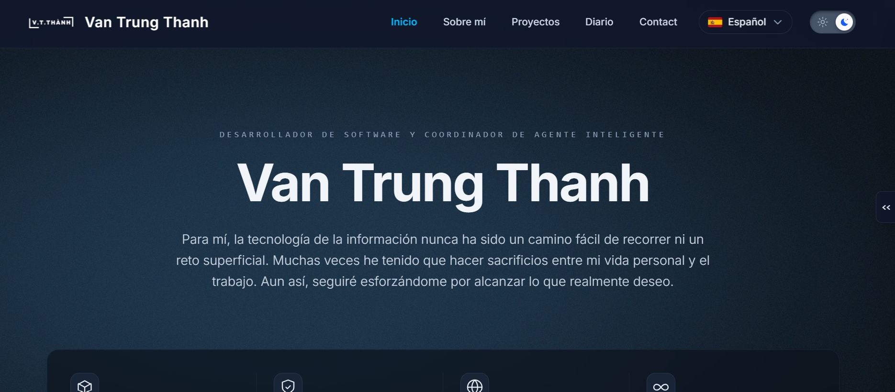

   # Home of V.T.Thanh (2026 - 2027)

  

  
<strong>Home of Van Trung Thanh - A Website Portfolio Rework</strong>

   

  
  
  
  
  
  
  

## I. Introduction

Rebuilding my personal home website from the ground up using Angular 22 and Spring Boot 4.11. While AI assists with high-level planning and architecture, 100% of the production code is hand-copied (Well, at least that’s the plan until the first bug hits and I start full turbo vibe coding with Gehihi and Codex again).

## II. Tech stacks

- CI/CD: Pre-commit (4.6.2), dependabot (2.0), CodeQL Action (4.38.3), and GitHub Actions (Public Repository Free tier)
- Backend: Spring boot (4.11)
- Frontend: Angular (22.x)
- Cloud: Vercel, Render, and Supabase.
- Containerization: Docker (29.8.2)
- LLM: Gwen 2.5 3B model, Gemini Embedding 001, Groq free tier model.
- Tools: uv (0.12.21), mage (1.17.2), docker-compose (v5.5.1).

## III. References

1. Previous Portfolio Design: [JuniorThanhBQ](https://www.juniorthanh.id.vn/)
2. Vercel Document: [Docs](https://vercel.com/docs)
3. Angular Document: [Docs](https://angular.dev/overview)
4. Spring boot Document: [Docs](https://docs.spring.io/spring-boot/index.html)
5. Internal Document: [Docs](docs/)
6. Inspiration: [Awwwards Website Design](https://www.awwwards.com/)
7. Domain Register (id.vn): [pavietnam](https://www.pavietnam.vn/)
8. DMCA Protected Explanation: [DMCA-PROTECTED](docs/license/dmca-protected.md)

## IV. Website Status

## V. Contact Information and Important Note

> [!NOTE]
>
> 1. Email: thanh.vantrung2005@gmail.com
> 2. LinkedIn: https://www.linkedin.com/in/juniorthanh09/
> 3. FCS-HCMCOU: https://it.ou.edu.vn/
> 4. Alternate email: juniorthanh09@gmail.com

> [!IMPORTANT]
>
> 1. Since this project is licensed under the MIT License, you are free to use this website design to build your own site (though I’m not sure why you’d want a website with such a janky aesthetic).
> 2. There are two areas you’ll need to adjust: `frontend/V.T.Thanh-Home-Angular/public/i18n` for multilingual static content, and `frontend/V.T.Thanh-Home-Angular/src/assets/cloudinaryUrl.ts` to update some of the images used on the site.
> 3. Final words: You will need to handle the setup of environment variables, your Vercel account, and other similar requirements yourself. If you have any questions, please feel free to reach out via my primary email.

## VI. Home Page

> Vietnamese
> 

> English
> 

> French
> 

> Japanese
> 

> German
> 

> Chinese
> 

> Russian
> 

> Korean
> 

> Spanish
> 
